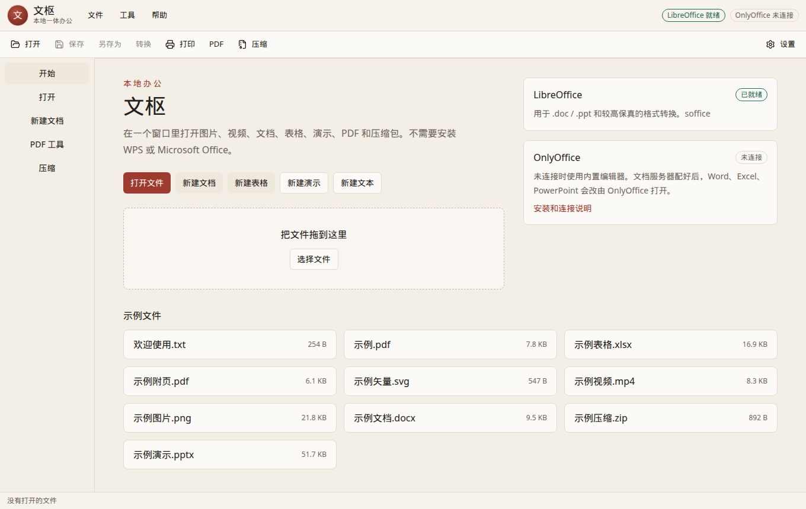
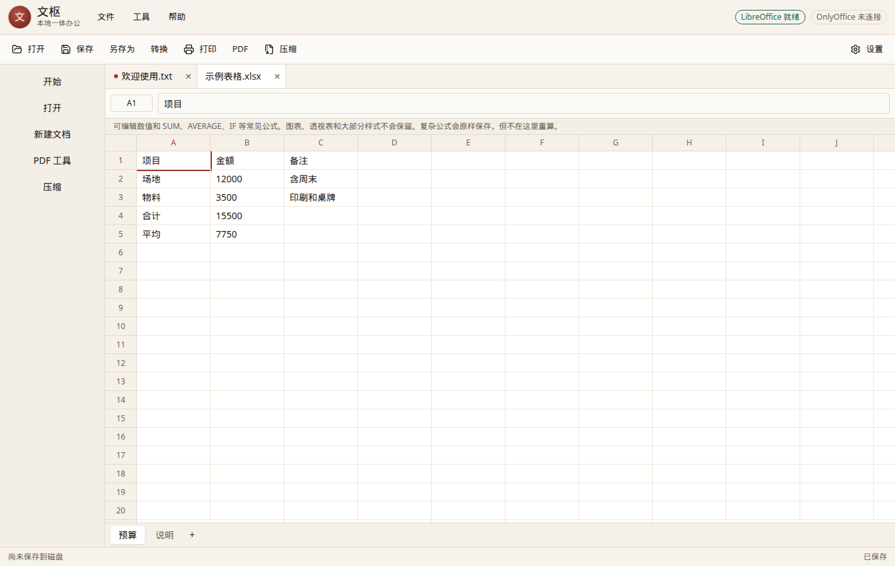
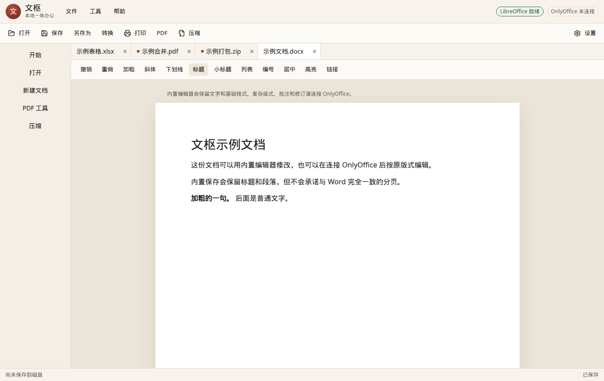
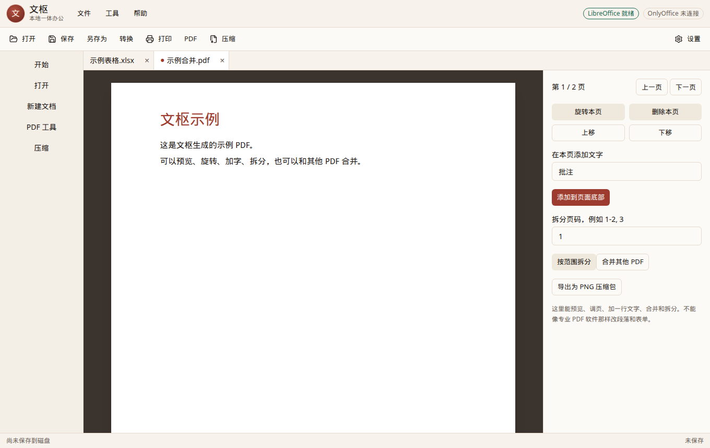
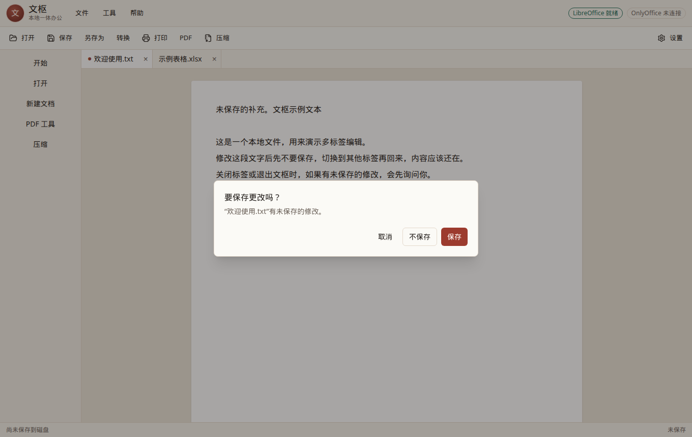

# 文枢

本地一体办公原型。一个窗口里打开图片、视频、文档、表格、演示、PDF 和压缩包，不依赖已经安装的 WPS 或 Microsoft Office。

界面是简体中文。这是第一版可运行原型，用来把打开、编辑、保存、转换、打印、PDF 和压缩这些主路径跑通。

## 现在能做什么

- 多标签打开图片（png、jpg、gif、webp、bmp、svg）和视频（mp4、webm；mov、mkv 取决于系统解码器）。
- 编辑并保存 `.txt`。
- 用 SheetJS 打开、修改、保存 `.xlsx`、`.xls`、`.csv`。数值和 `SUM`、`AVERAGE`、`IF` 等常见公式会当场计算；不认识的公式会原样保留。
- 用 Mammoth 读入 `.docx`，用富文本编辑后通过 html-to-docx 保存。适合改文字和基础格式。
- 预览 `.pptx` 里的文字和图片，并改已有文本框里的文字后保存。
- PDF：预览、合并、按页码拆分、旋转、删页、调序、加一行文字、导出为 PNG 压缩包、把 PNG/JPEG 合成 PDF。
- ZIP：查看、预览、添加、移除、打包、解压。桌面版可以选文件夹解压；浏览器里会下载文件。
- 另存为、转换、打印。有未保存修改时，切换标签会留在内存里；关闭标签或退出会询问是否保存。
- 检测到 LibreOffice 后，可以转换 `.doc`、`.ppt`、`.odt` 等，并做更高保真的导出。
- 配置 OnlyOffice 文档服务器后，`.docx`、`.xlsx`、`.pptx` 会改由 OnlyOffice 编辑。

`fixtures/` 里有可以直接打开的示例文件。

## 还做不到的事

- 没有云同步，没有多人同时编辑。
- 内置 Word 编辑不是 Word 排版引擎。复杂样式、页眉页脚、批注、修订、文本框在保存后可能变掉。完整版式请接 OnlyOffice，或用 LibreOffice 转换。
- 内置表格不保留图表、透视表和大部分单元格样式。跨表公式不会在这里重算。
- 内置演示只能改已经存在的文字，不能新建文本框、改动画或母版。
- PDF 只能做页面级操作和简单加字，不能像 Acrobat 那样改段落和表单。
- `.doc` / `.ppt` 不能在没有 LibreOffice 时直接编辑。这时会提示安装，其他功能照常可用。
- OnlyOffice 和 LibreOffice 都没有打进安装包，需要本机另外安装。

## 环境

- Node.js 20 或更新版本
- 建议用 pnpm。仓库自带 `pnpm-lock.yaml`
- Windows 10/11 64 位用来打包安装程序
- 可选：LibreOffice、Docker（用来跑 OnlyOffice）

国内下载 Electron 如果很慢，可以先设置镜像再安装：

```bat
set ELECTRON_MIRROR=https://npmmirror.com/mirrors/electron/
set ELECTRON_BUILDER_BINARIES_MIRROR=https://npmmirror.com/mirrors/electron-builder-binaries/
```

## 开发运行

```bash
pnpm install
pnpm fixtures   # 已提交示例文件，只有想重新生成时才需要
pnpm dev
```

也可以用 npm：

```bash
npm install --legacy-peer-deps
npm run dev
```

开发服务：

- 界面：<http://127.0.0.1:47231/>
- 本地 API：<http://127.0.0.1:47232/>（只监听本机）

`pnpm dev` 会同时打开 Electron 窗口。浏览器访问上面的界面地址也能操作同一套功能；系统文件对话框、退出确认和“打印到 PDF”在 Electron 里才是完整的。浏览器里保存会下载文件，打印会走浏览器的打印窗口。

检查：

```bash
pnpm test
pnpm typecheck
```

## 安装 LibreOffice

Windows 从 [LibreOffice 中文下载页](https://zh-cn.libreoffice.org/download/download/) 安装 64 位版本。文枢会查找：

`C:\Program Files\LibreOffice\program\soffice.exe`

如果装在别的位置，打开 **工具 → 引擎与设置**，填上 `soffice.exe` 的完整路径，再点“保存并重新检测”。

没有 LibreOffice 时，图片、视频、PDF、ZIP、文本、xlsx 和基础 docx 仍然可用。

## 连接 OnlyOffice

OnlyOffice 文档服务器负责高保真编辑。示例（需要 Docker）：

```bash
docker run -d --name wenshu-oo -p 8080:80 ^
  -e JWT_ENABLED=true ^
  -e JWT_SECRET=wenshu-secret ^
  onlyoffice/documentserver
```

然后在设置里填写：

| 项 | 示例 |
| --- | --- |
| 文档服务器 | `http://127.0.0.1:8080` |
| JWT 密钥 | `wenshu-secret` |
| 回访地址 | `http://host.docker.internal:47232` |

回访地址是文档服务器用来下载正在编辑的文件、并把保存结果送回来的地址。Docker Desktop 一般用 `host.docker.internal`。如果容器连不上，勾选“允许文档服务器从其他网卡访问本机”并重启文枢。这个开关会让 47232 端口不再只绑定回环地址，只在你需要时打开。

未连接时，应用会提示并自动改用内置编辑器。

## 打印

- **打印**：Electron 弹出系统打印对话框。PDF 会先交给系统 PDF 查看器再打印。
- **转换 → PDF（按当前编辑内容）**：把当前文字、表格或文档排成 PDF。没有打印机时用这条。
- 已安装 LibreOffice 时，转换里会多一项 **PDF（LibreOffice）**，尽量按原文件版式导出。

## 打包 Windows 程序

在 Windows 上：

```bat
pnpm install
pnpm build:win
```

产物在 `release/`：

- `文枢 Setup 0.1.0.exe`：NSIS 安装包，可选安装目录
- `文枢-0.1.0-win.zip`：免安装压缩包，解压后运行 `wenshu.exe`

安装包不包含 LibreOffice 和 OnlyOffice。示例文件和中文字体会随程序一起放在资源目录。

免安装 zip 可以在 Linux 上交叉打出来，不需要 Wine。NSIS 安装包在 Linux 上打包需要 Wine；没有 Wine 时安装包步骤会失败，zip 和 `release/win-unpacked/wenshu.exe` 仍然可用。在 Windows 上直接运行 `pnpm build:win` 会同时得到安装包和 zip。

Linux 开发机可以打 AppImage：

```bash
pnpm build:linux
```

## 示例文件

| 文件 | 用来看什么 |
| --- | --- |
| `欢迎使用.txt` | 改字、切换标签、关闭时的保存提示 |
| `示例文档.docx` | 内置文档编辑 |
| `示例表格.xlsx` | 公式（合计、平均） |
| `示例演示.pptx` | 幻灯片文字 |
| `示例图片.png` / `示例矢量.svg` | 图片查看 |
| `示例视频.mp4` | 播放 |
| `示例.pdf` / `示例附页.pdf` | 预览、合并、拆分 |
| `示例压缩.zip` | 解压和预览 |

开始页可以直接点这些文件。PDF 工具和压缩页也各有一个“用示例文件”按钮。

## 目录

```text
electron/        窗口、对话框、打印、本地 API、LibreOffice、OnlyOffice
src/             界面
src/core/        表格、PDF、ZIP、演示、文档这些不依赖界面的内核
src/editors/     各类标签的编辑器
fixtures/        示例文件
assets/fonts/    文泉驿微米黑，用来往 PDF 里写中文
scripts/         生成图标、示例文件和界面冒烟脚本
```

本地 API 只给本机界面用，没有账号系统。不要把它暴露到局域网，除非你明确打开了 OnlyOffice 回访开关。

## 界面











## 第三方

- 表格文件：SheetJS (`xlsx`)
- 文档读入：Mammoth；文档写出：html-to-docx
- PDF：pdf-lib、PDF.js
- 压缩：JSZip
- 演示读写：pptxgenjs 与 OOXML
- 可选高保真编辑：OnlyOffice Document Server
- 可选格式转换：LibreOffice
- PDF 中文：文泉驿微米黑（Apache-2.0 或 GPL-3.0，见 `assets/fonts/NOTICE.txt`）

## 许可证

应用代码为 MIT。上面这些依赖各自遵循自己的许可证。OnlyOffice 社区版是 AGPL，LibreOffice 是 MPL。
